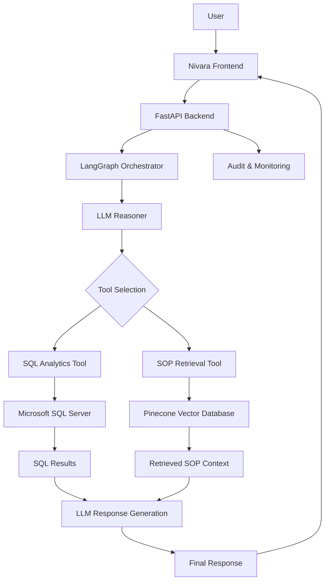
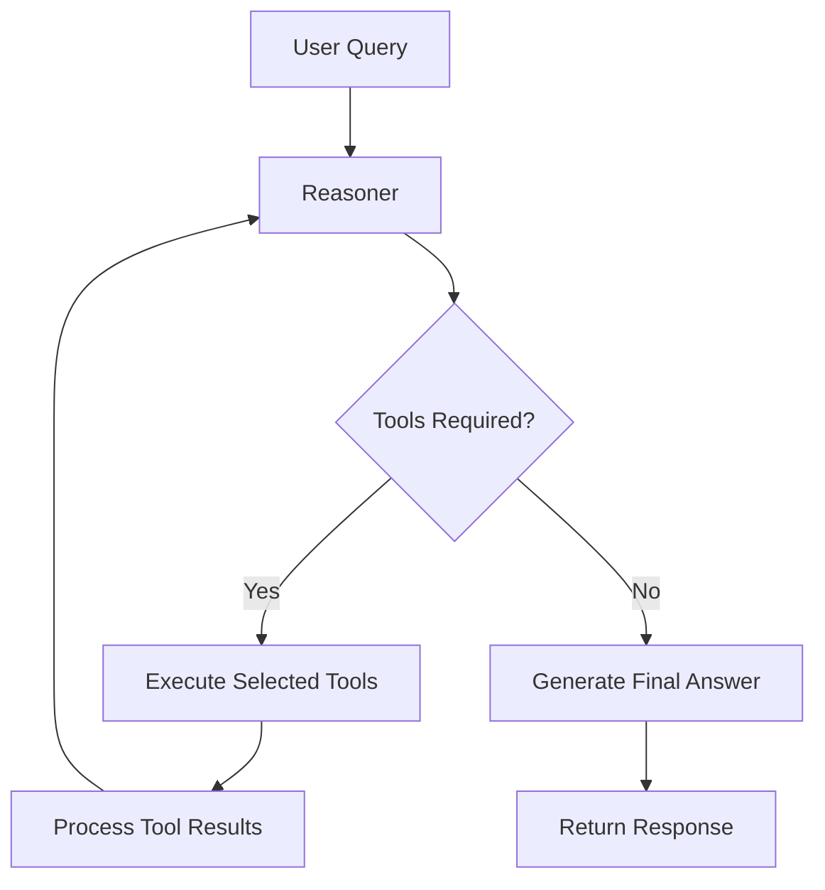

<h1>
<p align="center"> 🌿 NIVARA </p>
</h1>
<h2>
<p align="center"> Intelligent Cold Chain Orchestration Platform </p>
</h2>
An AI-powered logistics intelligence and orchestration platform combining Agentic AI, Retrieval-Augmented Generation (RAG), SQL analytics, and safety guardrails to transform cold-chain operations into intelligent, data-driven workflows.

<p align="center">
  
  
  
  
  
  
</p>

<p align="center">
  <b>Intelligent Decisions. Reliable Operations. Safer Supply Chains.</b>
</p>

---

## 📌 Overview

Nivara is an intelligent cold-chain orchestration platform designed to improve operational visibility, streamline logistics investigations, and support data-driven decision-making across supply-chain operations.

Traditional logistics monitoring systems primarily rely on static dashboards, manually written SQL queries, and disconnected operational documentation.

Nivara takes a different approach.

It introduces an **Agentic AI architecture** that allows users to interact with logistics data using natural language. An intelligent orchestration layer interprets user queries, determines the appropriate tools, retrieves relevant Standard Operating Procedures (SOPs), executes controlled database operations, and generates contextual responses.

The platform combines two major intelligence layers:

* **Operational Intelligence:** Analyzes structured logistics and fleet data using SQL.
* **Knowledge Intelligence:** Retrieves relevant operational policies and SOP documentation using RAG.

These capabilities work together through a LangGraph-powered orchestration system.

### 🎯 Project Objectives

* Transform natural-language questions into actionable operational insights.
* Enable intelligent investigation of logistics and fleet performance.
* Retrieve relevant SOPs and compliance documentation.
* Reduce dependency on manually written SQL queries.
* Implement controlled database access and AI safety guardrails.
* Provide a unified conversational interface for operational intelligence.

---

## ⭐ Key Features

### 1. 🤖 Agentic AI Orchestration

Nivara uses LangGraph to coordinate an intelligent agent workflow.

Unlike traditional question-answering chatbots, the orchestrator determines which tools are required to answer a query.

**Capabilities:**

* Natural-language query understanding.
* Intelligent tool selection.
* Conditional workflow execution.
* Multi-step reasoning and tool invocation.
* Context-aware response generation.
* Controlled execution through graph-based workflows.

The orchestration workflow follows:

`User Query → Reasoner → Tool Selection → Tool Execution → Reasoner → Final Response`

The system uses a conditional tool-routing mechanism to decide whether additional tool execution is necessary.

### 2. 🔍 Retrieval-Augmented Generation (RAG)

Nivara integrates a RAG pipeline to provide context-aware answers using operational SOP documentation.

**Core capabilities:**

* SOP document ingestion.
* Document processing and embedding generation.
* Semantic similarity search.
* Pinecone-powered vector retrieval.
* Context injection into LLM prompts.
* Knowledge-grounded response generation.

Instead of relying exclusively on the LLM's internal knowledge, the system retrieves relevant operational documentation before generating an answer.

**Technology:** Pinecone, LangChain, Embedding Models, DeepSeek API.

### 3. 📊 SQL-Based Logistics Intelligence

The platform connects to Microsoft SQL Server to analyze structured logistics and fleet information.

Users can ask operational questions without manually writing SQL queries.

**Examples:**

* How many fleet records are available?
* What is the average delivery delay?
* Show operational performance statistics.
* Investigate fleet-related exceptions.
* Retrieve relevant logistics records.

**Database capabilities:**

* Structured logistics data ingestion.
* SQL-based analytics.
* Database views for controlled access.
* Aggregation and filtering.
* Guarded query execution.
* Operational statistics through API endpoints.

### 4. 🛡️ SQL Safety & AI Guardrails

Database security is an important component of Nivara.

The platform incorporates SQL guardrails to reduce the risks associated with AI-generated database queries.

**Security considerations:**

* Controlled database operations.
* Restricted query execution.
* Read-only analytics access where configured.
* SQL validation and safety checks.
* Database views for controlled data exposure.
* Protection against potentially destructive operations.

The objective is to ensure that the AI agent does not receive unrestricted database access.

### 5. 🧠 Context-Aware LLM Integration

Nivara uses DeepSeek API as its cloud-based reasoning model.

The LLM works with the orchestration layer, retrieved SOP context, and SQL tool outputs to generate relevant responses.

**Capabilities:**

* Natural-language understanding.
* Context-aware reasoning.
* Tool-calling workflows.
* Structured operational responses.
* Retrieval-grounded generation.

### 6. 📈 Operational Analytics Dashboard

Nivara provides a dedicated frontend connected to FastAPI endpoints.

The dashboard is designed to present logistics information and allow users to investigate operational questions through a conversational interface.

**Dashboard capabilities:**

* Operational statistics.
* Logistics data insights.
* Conversational AI interface.
* API-driven information retrieval.
* Interactive operational investigation.

### 7. 📝 Audit & Observability

The platform includes an audit API endpoint to support operational traceability.

The architecture is designed to support:

* Tracking operational requests.
* Monitoring agent execution.
* Investigating tool interactions.
* Recording relevant audit information.
* Identifying failures during execution.

---

## 🏗️ System Architecture

Nivara follows a modular architecture that separates the frontend, API layer, AI orchestration, retrieval system, and structured database.



### Agent Execution Workflow



The graph-based orchestration architecture supports iterative reasoning and tool execution.

The current implementation also incorporates:

* Conditional tool routing.
* ToolNode execution.
* MemorySaver checkpointing.
* A maximum graph execution limit of 14 steps.

---

## 🛠️ Technology Stack

| Category             | Technology                | Purpose                                     |
| -------------------- | ------------------------- | ------------------------------------------- |
| Programming Language | Python                    | Core backend and AI development             |
| Backend Framework    | FastAPI                   | REST API development                        |
| Agent Framework      | LangGraph                 | Agent orchestration and workflow management |
| LLM Framework        | LangChain                 | LLM and tool integration                    |
| LLM Provider         | DeepSeek API              | AI reasoning and response generation        |
| RAG Framework        | LangChain                 | Retrieval pipeline                          |
| Vector Database      | Pinecone                  | SOP vector storage and retrieval            |
| Database             | Microsoft SQL Server 2022 | Structured logistics data                   |
| Data Processing      | Pandas                    | Data ingestion and processing               |
| Frontend             | HTML, CSS, JavaScript     | User interface                              |
| Infrastructure       | AWS EC2                   | Backend and database infrastructure         |
| Containerization     | Docker                    | SQL Server containerization                 |
| Testing              | Pytest                    | Automated testing                           |
| Version Control      | Git & GitHub              | Source code management                      |

---

## 📂 Dataset & Data Engineering

Nivara uses a logistics dataset:

`dynamic_supply_chain_logistics_dataset.csv`

The dataset is ingested into Microsoft SQL Server for structured querying and operational analytics.

### Data Ingestion Pipeline

```text
CSV Dataset
     |
     v
Python Ingestion Script
     |
     v
Data Processing
     |
     v
Microsoft SQL Server
     |
     v
Database Tables & Views
     |
     v
SQL Analytics Tools
     |
     v
AI Orchestrator
```

### Dataset Statistics

| Metric              |                       Value |
| ------------------- | --------------------------: |
| Total Fleet Records |                      32,065 |
| Database            |   Microsoft SQL Server 2022 |
| Primary Raw Table   | `dbo.TBL_SC_FLEET_HIST_RAW` |
| Analytics View      | `FDE_VIEWS.VW_ACTIVE_FLEET` |

The database ingestion was verified using SQL aggregation queries.

Example:

```sql
SELECT COUNT(*) AS Total_Fleet_Records
FROM FDE_VIEWS.VW_ACTIVE_FLEET;
```

**Verified result: 32,065 records.**

---

## 🧪 Testing & Quality Assurance

Reliability is an important part of Nivara's engineering architecture.

The project includes automated tests using Pytest to validate important backend components and safety mechanisms.

### Test Coverage Areas

| Test File                            | Testing Objective                             |
| ------------------------------------ | --------------------------------------------- |
| `tests/test_database.py`             | Database connectivity and database operations |
| `tests/test_orchestrator_routing.py` | Agent routing and orchestration behavior      |
| `tests/test_sql_guardrails.py`       | SQL validation and query safety               |

### Running Tests

Install the required dependencies:

```bash
pip install -r requirements.txt
```

Run the complete test suite:

```bash
python -m pytest tests/ -v
```

Run individual test modules:

```bash
python -m pytest tests/test_database.py -v

python -m pytest tests/test_orchestrator_routing.py -v

python -m pytest tests/test_sql_guardrails.py -v
```

Generate a test coverage report:

```bash
pip install pytest-cov

python -m pytest tests/ \
    --cov=src \
    --cov-report=term-missing
```

### Quality Assurance Priorities

* Database operation reliability.
* Correct agent tool routing.
* Safe SQL execution.
* API response validation.
* Error handling.
* Retrieval reliability.
* Consistent orchestration behavior.

---

## 📊 Performance & Evaluation

Nivara is designed around operational intelligence rather than conventional image-classification or prediction accuracy.

Therefore, traditional classification accuracy is not an appropriate single performance metric for this platform.

The following metrics are important for evaluating the system:

| Evaluation Metric          | Description                                                  |
| -------------------------- | ------------------------------------------------------------ |
| Tool Selection Accuracy    | Percentage of queries routed to the correct tool             |
| Retrieval Precision@K      | Relevance of retrieved SOP documents                         |
| Retrieval Recall@K         | Coverage of relevant SOP documents                           |
| Answer Faithfulness        | Whether generated answers are supported by retrieved context |
| SQL Execution Success Rate | Percentage of valid queries executed successfully            |
| Response Latency           | Time required to generate a response                         |
| Guardrail Effectiveness    | Ability to block unsafe database operations                  |
| Test Pass Rate             | Percentage of automated tests passing                        |

### Current Operational Data

The existing statistics API has returned the following aggregate values:

| Metric                    | Observed Value |
| ------------------------- | -------------: |
| Total Fleet Records       |         32,065 |
| Average Delay Field       |   0.6990768457 |
| Average Temperature Field |   0.0447916701 |

*Note: The delay and temperature figures are raw API-reported aggregates. Their units and business interpretation should be confirmed against the dataset schema before treating them as operational performance indicators.*

### Accuracy & Benchmarking

No independently verified end-to-end accuracy percentage has been established yet.

The next evaluation milestone is to create a benchmark dataset containing representative operational questions, expected tool selections, relevant SOP documents, and reference answers.

This will make it possible to measure retrieval quality, agent routing accuracy, answer faithfulness, and execution reliability objectively.

---

## 🔌 API Endpoints

The FastAPI backend currently exposes the following primary endpoints:

| Method | Endpoint      | Description                      |
| ------ | ------------- | -------------------------------- |
| GET    | `/api/health` | Backend health check             |
| POST   | `/api/chat`   | Submit conversational AI queries |
| GET    | `/api/stats`  | Retrieve operational statistics  |
| POST   | `/api/audit`  | Audit-related operations         |

### Example API Request

```http
POST /api/chat
Content-Type: application/json
```

The endpoint accepts conversational queries from the frontend and passes them through the backend orchestration workflow.

*Refer to the API implementation for the exact request and response schemas.*

---

## 🚀 Installation & Setup

### Prerequisites

* Python 3.12+
* Git
* Docker
* Microsoft SQL Server 2022
* Pinecone account and API key
* DeepSeek API key

### 1. Clone the Repository

```bash
git clone https://github.com/atul-vish/Nivara.git

cd Nivara
```

### 2. Create Virtual Environment

```bash
python -m venv .venv
```

Activate it on Windows:

```powershell
.venv\Scripts\activate
```

Activate it on Linux/macOS:

```bash
source .venv/bin/activate
```

### 3. Install Dependencies

```bash
pip install -r requirements.txt
```

### 4. Configure Environment Variables

Create a `.env` file in the project root.

```env
SQL_SERVER_HOST=localhost
SQL_SERVER_PORT=1433
SQL_ADMIN_USER=sa
SQL_ADMIN_PASSWORD=your_password

PINECONE_API_KEY=your_pinecone_api_key

DEEPSEEK_API_KEY=your_deepseek_api_key
```

Configure any additional environment variables required by your database, vector index, and application configuration.

**Security:** Never commit `.env`, API keys, database passwords, or other secrets to GitHub.

### 5. Start the Backend

```bash
uvicorn src.ui:app --host 127.0.0.1 --port 8000 --reload
```

### 6. Access the API

Backend:

```text
http://localhost:8000
```

Health check:

```text
http://localhost:8000/api/health
```

---

## ☁️ Deployment Architecture

Nivara has been developed with cloud deployment in mind.

The infrastructure work includes:

* AWS EC2 for backend and database infrastructure.
* Docker-based Microsoft SQL Server deployment.
* SSH tunneling for secure development-time database connectivity.
* FastAPI application served through Uvicorn.
* Environment-based configuration.
* Systemd service management for persistent backend execution.

The planned frontend/backend hosting architecture uses:

| Component               | Deployment Platform  |
| ----------------------- | -------------------- |
| Frontend                | Vercel               |
| FastAPI Backend         | Render               |
| Database Infrastructure | AWS EC2 / SQL Server |
| Vector Database         | Pinecone             |
| LLM                     | DeepSeek API         |

Production deployment should use private database networking, authenticated API access, HTTPS, and managed secrets.

---

## 🔐 Security Considerations

Nivara incorporates security at the application and database levels.

Important considerations include:

* Environment-based secret management.
* Restricted SQL execution.
* Controlled database views.
* Query validation.
* Separation of application and database credentials.
* SSH-based infrastructure access.
* Controlled agent tool execution.

The goal is to make AI-driven operational workflows more predictable, traceable, and secure.

---

## 🔮 Future Roadmap

Planned improvements include:

* [ ] Comprehensive RAG evaluation using RAGAS or DeepEval.
* [ ] Automated agent-routing benchmarks.
* [ ] Retrieval latency optimization.
* [ ] Advanced SQL query performance optimization.
* [ ] Expanded operational anomaly detection.
* [ ] More comprehensive audit logging.
* [ ] Role-based access control.
* [ ] Improved observability and execution tracing.
* [ ] Production-grade CI/CD pipeline.
* [ ] End-to-end API and integration testing.
* [ ] Advanced logistics forecasting and predictive analytics.

---

## 💡 What Makes Nivara Different?

Nivara is not simply another chatbot connected to a database.

It brings together several important AI engineering concepts into a unified application:

| Traditional Approach              | Nivara Approach                         |
| --------------------------------- | --------------------------------------- |
| Static operational dashboards     | Conversational operational intelligence |
| Manually written SQL              | AI-assisted SQL analytics               |
| Keyword-based document search     | Semantic SOP retrieval                  |
| Single-step chatbot responses     | Graph-based agent orchestration         |
| Unrestricted AI-generated queries | SQL safety guardrails                   |
| Disconnected information sources  | Unified operational intelligence        |

The central idea is to combine structured enterprise data, unstructured operational knowledge, and intelligent agent workflows into a single system.

---

## 👨‍💻 Author

**Atul Vishwakarma**

AI/ML Engineer | Generative AI | Agentic AI | Forward-Deployed Engineering

GitHub: https://github.com/atul-vish

---

## ⭐ Support

If you find Nivara interesting, consider giving this repository a ⭐ on GitHub.

Contributions, suggestions, and feedback are welcome.

---

<p align="center">
  <b>Built with Python, Agentic AI, RAG, and a focus on real-world operational intelligence.</b>
  <br>
  <i>NIVARA — Making Cold Chain Operations Intelligent.</i>
</p>
